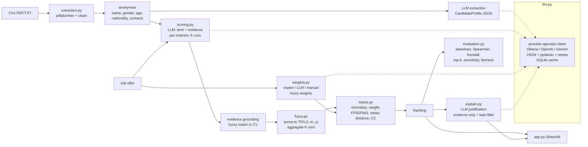

# LLM + Fuzzy TOPSIS for Personnel Selection through Automated Profile Analysis

Course project — *Generative AI & Multi-Criteria Decision Making*.

A large language model reads CVs, rates every candidate against a job offer with
**linguistic terms backed by evidence quotes**, the terms become **triangular fuzzy
numbers**, and a **Fuzzy TOPSIS implemented from scratch** (Chen, 2000) ranks the
candidates. The LLM then explains each rank using only the collected evidence. A
Streamlit dashboard exposes the whole pipeline.

## Architecture



## Project layout

```
config/criteria.yaml      criteria C1..C6 (benefit/cost, descriptions used in prompts)
data/raw, processed       public datasets (scripts/download_data.py)
data/synthetic            20 synthetic CVs, 2 job offers, ground truth (scripts/generate_synthetic.py)
src/llm.py, cache.py      LLM wrapper (JSON-only, pydantic validation, self-repair retries, cache)
src/extraction.py         CV parsing, anonymisation, structured extraction
src/scoring.py            linguistic scoring with evidence, grounding check, K-run stability
src/fuzzy.py              triangular fuzzy numbers, linguistic scales, aggregation, distances
src/topsis.py             Fuzzy TOPSIS (from scratch) + crisp TOPSIS + weighted sum
src/weights.py            fuzzy weights: expert preset, LLM suggestion, combination, crisp
src/explain.py            LLM explanations with protected-attribute filter
src/evaluation.py         metrics, TF-IDF baseline, sensitivity, counterfactual fairness
src/synthetic.py          benchmark generator with deterministic ground truth
src/pipeline.py           end-to-end orchestration (shared by app and scripts)
src/reference_examples.py Chen (2000) numerical example (validation)
scripts/run_experiments.py   reproduces every table in results/
notebooks/results.ipynb      tables and figures from results/
tests/                    pytest unit tests (no LLM needed: fake backend)
report_notes.md           report material (theory, method, results, critical analysis)
```

## Install

```bash
python -m venv .venv
.venv\Scripts\activate            # Windows  (source .venv/bin/activate on Linux/macOS)
pip install -r requirements.txt
copy .env.example .env            # then edit if needed
```

Local LLM (default):

```bash
# https://ollama.com
ollama pull qwen3.5:4b
```

Or set `LLM_PROVIDER=openai` + `OPENAI_API_KEY`, or `LLM_PROVIDER=gemini` + `GEMINI_API_KEY`.

## Run

```bash
pytest                                            # unit tests (offline)
python -m scripts.run_experiments --steps crosscheck   # Chen 2000 validation, no LLM
python -m scripts.generate_synthetic              # synthetic benchmark (LLM-written CVs, cached)
python -m scripts.run_experiments --steps synthetic,fairness --model qwen3.5:4b
python -m scripts.download_data                   # optional: Kaggle / HF datasets
python -m scripts.run_experiments --steps real
streamlit run app.py                              # dashboard
jupyter nbconvert --to notebook --execute notebooks/results.ipynb
```

Every LLM call is cached in `.cache/llm_cache.sqlite` keyed by
(provider, model, prompt, temperature, seed, schema): re-running any script reproduces
the same numbers without calling the model again. Seeds are fixed (`SEED=42`, benchmark seed 7).

## Data sources

| Dataset | Use | Access |
|---|---|---|
| Kaggle `snehaanbhawal/resume-dataset` (Livecareer, ~2.4k CVs, 24 categories) | real-data weak-label test | Kaggle API token |
| Hugging Face `ahmedheakl/resume-atlas` | alternative real CV source | public |
| Kaggle `arshkon/linkedin-job-postings` | real job offers | Kaggle API token |
| `data/synthetic` (generated) | ground-truth evaluation | this repo |

Check each dataset page for its licence before redistributing the data; raw data is
git-ignored and is not shipped with the project.

## Key results (real runs, qwen3.5:4b on CPU; details in `report_notes.md`, files in `results/`)

| | Result |
|---|---|
| Chen (2000) example | same ranking A2>A3>A1, CC2/CC3 identical; the paper's d1* = 2.10 is an arithmetic erratum (its own Table 7 gives 1.94 → CC1 = 0.64) |
| vs pyDecision (same ideal-point definition) | max abs CC difference 1.1e-16 |
| Synthetic benchmark, Spearman ρ vs ground truth (J1 / J2) | Fuzzy TOPSIS 0.75 / 0.78, crisp TOPSIS 0.77 / 0.81, SAW 0.79 / 0.81, TF-IDF 0.76 / 0.84, oracle ratings 0.94 / 0.96 |
| Best candidate found (top-1) | Fuzzy TOPSIS 2/2 jobs, TF-IDF 1/2 |
| Weight robustness | top-1 unchanged for every single weight ×0.5…×1.5 and in 100 % of 2,000 Monte-Carlo draws (±30 %) |
| Counterfactual fairness (same CV, swapped name/gender/age/nationality) | without anonymisation 50 % of scores change (max ΔCC 0.11, mean rank shift 1.6); with anonymisation 0 change |
| Explanations mentioning protected attributes | 0 / 40 |
| Real CVs (Kaggle, weak labels), precision@6 IT / Accountant | Fuzzy TOPSIS 0.67 / 0.83, TF-IDF 0.83 / 0.83 (random 0.30) |

Main lesson: the bottleneck is the LLM's ratings (experience and soft skills), not the MCDM
method; fuzziness brings transparency about uncertainty and robustness rather than raw accuracy.

## Method in one paragraph

Criteria C1 technical skills, C2 experience, C3 education, C4 certifications, C5 soft
skills, C6 languages (all benefit). For each candidate the LLM returns one of
*Very Low, Low, Medium, High, Very High* per criterion plus a verbatim quote; quotes not
found in the CV are downgraded. Terms map to TFNs on [0,1]; with 3 runs the runs are
aggregated like 3 decision makers (l = min, m = mean, u = max). Fuzzy TOPSIS:
linear normalisation r = (l/u*, m/u*, u/u*), weighting v = r ⊗ w, FPIS (1,1,1), FNIS (0,0,0),
vertex distance d = √(⅓Σ(Δ)²), CC = d⁻/(d*+d⁻). See `report_notes.md` for equations
and results.
